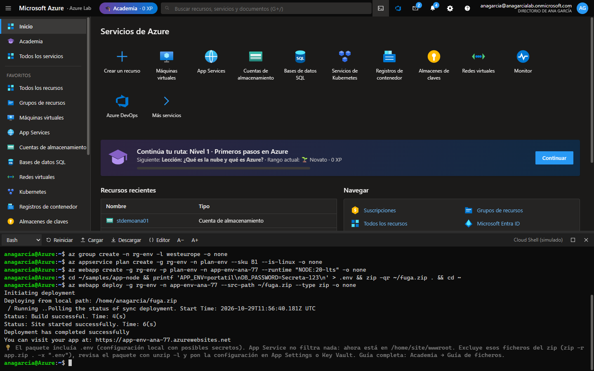
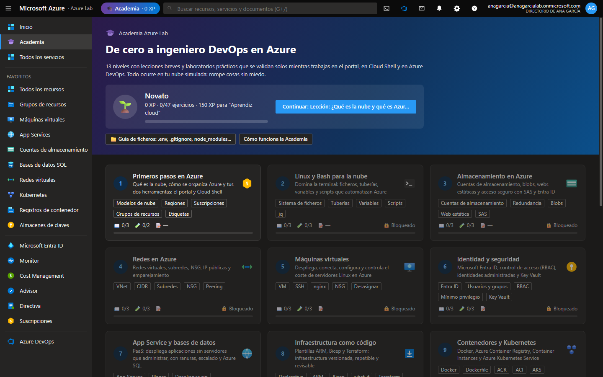
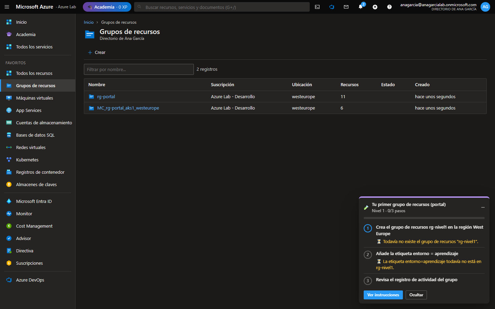
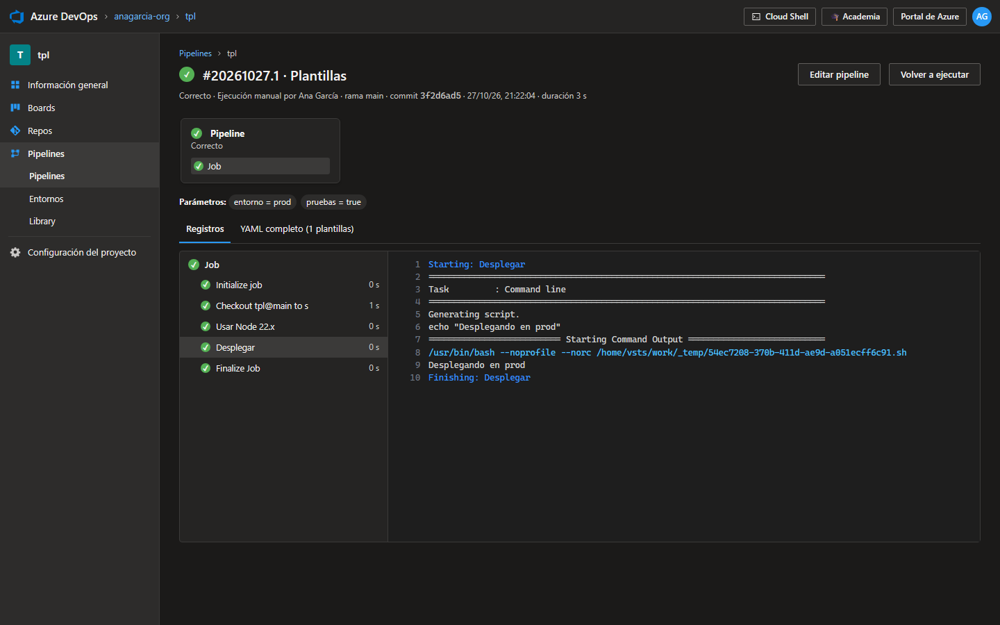

# Azure Lab

**Tu Azure privado para aprender DevOps.** Un simulador de Microsoft Azure que funciona en tu ordenador: portal, Cloud Shell, Azure DevOps y una academia de 13 niveles con 47 laboratorios que se corrigen solos mientras trabajas. Sin cuenta, sin tarjeta y sin miedo a la factura.



> **Aviso:** proyecto educativo independiente, sin relación con Microsoft. Microsoft, Azure y Azure DevOps son marcas de Microsoft Corporation. Azure Lab no se conecta a Azure: todo se simula en tu equipo.

## Por qué existe

Para aprender Azure de verdad hace falta practicar, y practicar en una suscripción real tiene dos problemas: necesitas una tarjeta, y un error (una máquina virtual olvidada, un clúster encendido el fin de semana) cuesta dinero.

Azure Lab reproduce los comandos, los mensajes de error, los tiempos y los conceptos de Azure para que puedas romper cosas sin consecuencias. Lo que practicas aquí lo puedes usar tal cual en una suscripción real.

## Qué incluye

- **Portal de Azure**: grupos de recursos, máquinas virtuales (con apagado automático), App Service (con dominios personalizados y Kudu), almacenamiento (blobs, Azure Files y colas), redes, Azure DNS, SQL, Key Vault, Service Bus, contenedores (ACR, ACI, AKS), Microsoft Entra ID, Monitor, Resource Graph, Cost Management, Advisor y Azure Policy. Cada asistente de creación muestra el comando de Azure CLI equivalente.
- **Cloud Shell**: un Bash simulado con `az`, `kubectl`, `terraform`, `git`, `docker`, `jq`, `curl`, `ssh`, `sqlcmd`, un editor (`code`) y proyectos de ejemplo en `~/samples`.
- **Azure DevOps**: Boards, Repos (ramas, pull requests y directivas de rama), Pipelines YAML con agentes simulados (`AzureCLI@2`, `AzureWebApp@1`, `Docker@2`, `KubernetesManifest@1`, `TerraformTaskV4@4`...), plantillas, parámetros en tiempo de ejecución, entornos con aprobaciones, Library y conexiones de servicio.
- **Academia**: 13 niveles con lecciones, 47 laboratorios que **se validan solos** (los hagas en el portal, en Cloud Shell o con un pipeline), cuestionarios, XP y rangos hasta «Auténtico DevOps».
- **Guía de ficheros**: qué se sube a Git, qué viaja en un despliegue y qué no debe salir nunca de tu ordenador (`.env`, `node_modules`, `terraform.tfstate`, claves...).

## Pruébalo

### Con Docker (recomendado)

Sólo necesitas [Docker Desktop](https://www.docker.com/products/docker-desktop/).

```bash
git clone https://github.com/SalmeronDevZone/azure-lab.git
cd azure-lab
docker compose up -d --build
```

Abre **http://localhost:8090**. Tu nube y tu progreso se guardan en un volumen de Docker: sobreviven aunque borres o actualices el contenedor.

### Con Node.js

Necesitas [Node.js](https://nodejs.org) 20 o superior.

```bash
git clone https://github.com/SalmeronDevZone/azure-lab.git
cd azure-lab
npm install
npm run dev
```

Se abre **http://localhost:5173**. En este modo tus datos se guardan en tu navegador.

La primera vez te pedirá tu nombre: con él se crean tu usuario y tu inquilino de Microsoft Entra ID simulados.

## Cómo se usa

1. Entra en la **Academia** (botón morado de la barra superior) y empieza por el nivel 1.
2. Lee las lecciones y abre un laboratorio. Pulsa **Empezar**: la Academia vigila tu nube simulada y marca cada paso en cuanto lo cumples. El panel flotante te acompaña mientras trabajas.
3. Cada paso tiene una **pista** y cada laboratorio una **solución de referencia**.

En **Configuración** (engranaje) puedes cambiar el tema, la velocidad de aprovisionamiento (instantánea, rápida o realista), activar el **modo libre** (todos los niveles desbloqueados), exportar o importar tus datos y restablecer la nube.

Los costes también se simulan: **1 minuto real = 1 hora facturada**. Detén o elimina lo que no uses, como harías en Azure.

| | |
| --- | --- |
|  |  |
| **La Academia**: 13 niveles, de cero a DevOps | **Un laboratorio**: cada paso se valida solo |



## Los 13 niveles

| Nivel | Tema |
| --- | --- |
| 1 | Primeros pasos en Azure: nube, jerarquía, portal, Cloud Shell y Azure CLI |
| 2 | Linux y Bash: ficheros, tuberías, variables, scripts y JSON |
| 3 | Almacenamiento: cuentas, blobs, web estática, SAS y acceso con Entra ID |
| 4 | Redes: VNet, subredes, NSG y emparejamiento |
| 5 | Máquinas virtuales: SSH, nginx, puertos y costes |
| 6 | Identidad y seguridad: Entra ID, RBAC, Key Vault e identidades administradas |
| 7 | App Service y Azure SQL: despliegues, configuración, ranuras, bases de datos, dominios propios con Azure DNS y mensajería con Service Bus |
| 8 | Infraestructura como código: ARM, Bicep y Terraform con estado remoto |
| 9 | Contenedores: Docker, ACR, ACI y AKS |
| 10 | Git y Azure Repos: ramas, pull requests y directivas |
| 11 | Azure Pipelines: CI/CD, artefactos, conexiones de servicio, aprobaciones, secretos y plantillas con parámetros |
| 12 | Observabilidad, costes y gobierno: alertas, KQL, Resource Graph, presupuestos, bloqueos y Azure Policy |
| 13 | Proyecto final: plataforma DevOps completa (y reto de CI/CD hacia AKS) |

## En un contenedor Docker

La imagen lleva la app ya compilada y un pequeño servidor (`server/server.mjs`, sin dependencias) que la sirve y guarda tu nube y tu progreso en disco.

```bash
docker compose up -d --build     # construir y arrancar, o actualizar tras cambiar el código
docker compose down              # parar (tus datos se conservan)
```

| Pieza | Dónde vive |
| --- | --- |
| La app compilada y el servidor | Dentro de la imagen y, por tanto, del contenedor |
| Tu nube (`nube.json`) y tu progreso (`academia.json`) | En el **volumen** `azlab-data`, montado en `/data` |
| El código fuente | Sólo en tu PC: la imagen final no lo lleva |

Qué conviene saber:

- **`docker compose down -v` borra el volumen**, y con él tu nube. No uses `-v` salvo que quieras empezar de cero.
- **Copia de seguridad**: `docker cp azure-lab:/data ./copia-azlab`, o el botón *Exportar* de Configuración.
- **Puerto**: tu PC usa el 8090 y el contenedor, por dentro, el 8080 (`"127.0.0.1:8090:8080"` en `docker-compose.yml`). Si el 8090 está ocupado («port is already allocated»), cambia el primer número.
- **Desde el móvil**: por defecto sólo responde en tu PC (`127.0.0.1`). Para abrirla en tu wifi, cambia el puerto a `"8090:8080"`. No tiene contraseña: no la expongas fuera de tu red.
- **Estado**: `docker ps` muestra `healthy` cuando la app responde, y `docker logs azure-lab` muestra lo que dice el servidor.
- `npm run dev` guarda sólo en tu navegador y no ve los datos del contenedor. Para pasar tu nube de uno a otro: *Exportar* en uno, *Importar* en el otro.
- Sin Docker, `npm run build && npm start` hace lo mismo y guarda en la carpeta `data/` del proyecto.

Si la usas en dos pestañas o dispositivos a la vez, el último guardado manda. Si cierras la pestaña justo mientras guardaba, ese cambio se recupera la próxima vez que abras la app en ese navegador, salvo que entretanto hayas guardado otra cosa desde otro sitio.

## Desarrollo

| Comando | Para qué |
| --- | --- |
| `npm run dev` | Servidor de desarrollo con recarga automática |
| `npm run build` | Comprueba los tipos y genera la versión de producción en `dist/` |
| `npm start` | Sirve `dist/` con el servidor de Azure Lab, que guarda tu nube en `data/` |
| `npm test` | Pruebas: comandos del shell, renderizado de todas las pantallas, el servidor y la solución de referencia de los 47 laboratorios |
| `npm run typecheck` | Sólo la comprobación de tipos |

Tecnologías: React 19, TypeScript, Vite, Vitest, Node.js y Docker. No hay base de datos ni servicios externos: la nube simulada es un objeto en memoria que se guarda en el navegador o, con Docker, en el volumen.

### Estructura del código

```
src/
├── engine/            Nube simulada (sin interfaz)
│   ├── store.ts       Estado global de la nube simulada
│   ├── persistence.ts Dónde se guarda: el navegador y, en Docker, el servidor
│   ├── arm.ts         Azure Resource Manager: RBAC, bloqueos, Policy, registro de actividad
│   ├── providers/     Tipos de recurso (VM, red, storage, web, SQL, Key Vault, contenedores, monitor...)
│   └── services/      Planos de datos y motores: storage, Kubernetes, ARM/Bicep, Terraform, KQL,
│                      SQL, red/HTTP, métricas y alertas, costes, Azure DevOps...
├── shell/             Bash simulado: parser, intérprete, comandos, Azure CLI (az/) y ejecutor de pipelines
└── ui/                React: portal, terminal, Azure DevOps y Academia
    └── academy/content/   El currículo (un fichero por cada par de niveles)
server/server.mjs      Servidor para Docker: sirve dist/ y guarda la nube en /data
tests/                 Pruebas con Vitest
docs/capturas/         Las imágenes de este README
```

### Ficheros del proyecto: qué se sube y qué no

| Fichero o carpeta | Para qué sirve | ¿A Git? |
| --- | --- | --- |
| `package.json` | Dependencias, scripts (`npm run dev`...) y versión mínima de Node (`engines`) | Sí |
| `package-lock.json` | Versiones exactas de todas las dependencias (lo usa `npm ci`) | Sí |
| `.nvmrc` | Versión de Node con la que trabaja el proyecto | Sí |
| `.gitignore` | Lo que Git debe ignorar | Sí |
| `tsconfig.json`, `vite.config.ts` | Configuración de TypeScript y de Vite | Sí |
| `src/`, `tests/`, `index.html`, `public/` | El código, las pruebas y la página | Sí |
| `server/` | El servidor que sirve la app y guarda tu nube (Docker y `npm start`) | Sí |
| `Dockerfile` | Receta de la imagen: compila en una etapa y ejecuta en otra, sin código fuente | Sí |
| `.dockerignore` | Lo que no se envía a Docker al construir (`node_modules`, `data/`, `.env`...) | Sí |
| `docker-compose.yml` | Cómo se arranca el contenedor: puerto, volumen y reinicio | Sí |
| `node_modules/` | Librerías descargadas por `npm install` / `npm ci` | No |
| `dist/` | Versión de producción generada por `npm run build` | No |
| `data/` | Tu nube guardada por `npm start` (en Docker vive en el volumen) | No |
| `.env` | Este proyecto no lo necesita: no tiene secretos | No |

La app enseña lo mismo dentro del simulador: **Academia → Guía de ficheros**.

### Añadir o modificar laboratorios

Los niveles están en `src/ui/academy/content/`. Un laboratorio es un objeto con un escenario, pasos y una solución:

```ts
{
  id: 'e3-mi-lab',
  title: 'Mi laboratorio',
  summary: 'Qué se practica',
  difficulty: 'Media',
  minutes: 10,
  scenario: 'Contexto en **markdown**.',
  steps: [
    {
      id: 'rg',
      title: 'Crea el grupo rg-mi-lab',
      detail: 'Instrucciones (markdown, los bloques ```bash tienen botón "Probar en Cloud Shell").',
      hint: 'Pista opcional.',
      // true = paso completado; un texto = por qué todavía no (se muestra al estudiante)
      check: (c) => (c.rg('rg-mi-lab') ? true : 'Todavía no existe rg-mi-lab.'),
    },
  ],
  solution: '```bash\naz group create -n rg-mi-lab -l westeurope\n```',
}
```

El contexto `c` (`src/ui/academy/checks.ts`) permite consultar recursos (`c.res`, `c.one`, `c.vm`, `c.site`...), comandos ejecutados (`c.ran`, `c.failed`), peticiones HTTP (`c.httpOk`), ficheros de Cloud Shell (`c.file`) y Azure DevOps (`c.project`).

`npm test` ejecuta la solución de referencia de cada laboratorio y comprueba que todos los pasos se validan; si añades uno, la prueba lo cubre automáticamente (o añade un guion equivalente en `tests/academy.test.ts` si la solución usa el portal).

## Límites del simulador

Es una simulación educativa: los servicios se comportan como en Azure en los escenarios de los laboratorios, pero no ejecutan código real (las aplicaciones Node.js/Python y los contenedores se interpretan), no hay red real y sólo se incluyen los servicios y comandos más usados. PowerShell no está disponible: todo se hace con Bash y Azure CLI.
